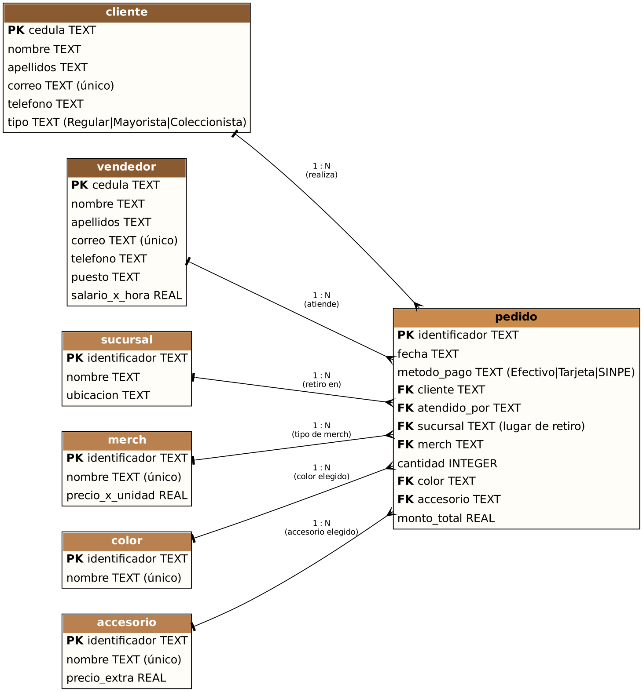

# Análisis y diseño – Tienda Capybara

## Nombre del proyecto
**Tienda Capybara** – sistema web para registrar y administrar los pedidos de merch de capibaras de una tienda con varios lugares de retiro.

## Descripción del problema
La tienda vende únicamente merch de capibaras y trabaja por pedido: cada cliente indica qué tipo de merch quiere, cuántas unidades, de qué color, con qué accesorio y en qué sucursal la va a retirar. Si esto se anota a mano, se pierden pedidos, se calculan mal los totales y no se sabe qué debe tener listo cada sucursal.

## Objetivo general
Ofrecer una aplicación web que registre los pedidos en SQLite con todos sus datos (merch, cantidad, color, accesorio y lugar de retiro), calcule automáticamente el total y permita consultar, modificar y eliminar la información.

## Principales funcionalidades
- Pantalla de **compra**: se elige cliente, tipo de merch, cantidad, color, accesorio, lugar de retiro, vendedor y método de pago; el servidor genera el identificador del pedido, la fecha y el total.
- Consulta de pedidos con su detalle completo, edición de sus datos y eliminación.
- CRUD de clientes, vendedores, lugares de retiro (sucursales), tipos de merch, colores y accesorios.
- Resumen con la cantidad de pedidos, unidades pedidas y total facturado.

## Usuarios
- **Vendedor / encargado de tienda:** registra los pedidos que piden los clientes y los consulta.
- **Administrador:** mantiene los tipos de merch con sus precios, colores, accesorios, lugares de retiro y personal.
- **Cliente:** aparece en el sistema como quien hace el pedido (tipo Regular, Mayorista o Coleccionista).

## Diagrama entidad-relación

(Fuente editable: `er.dot`; versión vectorial: `diagrama_er.svg`.)

## Descripción de las tablas

| Tabla | Llave primaria | Llaves foráneas | Descripción |
|---|---|---|---|
| `cliente` | `cedula` | – | Persona que pide: nombre, apellidos, correo único, teléfono y tipo (Regular, Mayorista o Coleccionista). |
| `vendedor` | `cedula` | – | Persona que atiende: nombre, apellidos, correo, teléfono, puesto y salario por hora. |
| `sucursal` | `identificador` | – | Lugar donde el cliente retira su pedido: nombre y ubicación. |
| `merch` | `identificador` | – | Tipo de merch (camiseta, taza, peluche...) con su precio por unidad. |
| `color` | `identificador` | – | Colores disponibles para el merch. |
| `accesorio` | `identificador` | – | Accesorios opcionales con su precio extra por unidad ("Sin accesorio" cuesta 0). |
| `pedido` | `identificador` | `cliente → cliente`, `atendido_por → vendedor`, `sucursal → sucursal`, `merch → merch`, `color → color`, `accesorio → accesorio` | Pedido realizado: fecha, método de pago, cantidad y total calculado. |

## Relaciones
- `cliente` 1 — N `pedido`: un cliente puede hacer muchos pedidos.
- `vendedor` 1 — N `pedido`: un vendedor atiende muchos pedidos.
- `sucursal` 1 — N `pedido`: en una sucursal se retiran muchos pedidos.
- `merch` 1 — N `pedido`, `color` 1 — N `pedido` y `accesorio` 1 — N `pedido`: cada pedido elige un tipo de merch, un color y un accesorio, y cada uno de ellos puede aparecer en muchos pedidos.

## Reglas de integridad
- `precio_x_unidad >= 0`, `precio_extra >= 0`, `cantidad > 0`.
- `tipo` y `metodo_pago` solo admiten los valores indicados.
- No se puede borrar un cliente, vendedor, sucursal, tipo de merch, color o accesorio que ya se use en un pedido (la API responde 409).
- `monto_total = (precio_x_unidad + precio_extra) × cantidad`, calculado siempre por el servidor. Cambiar el precio de un merch después no modifica pedidos ya registrados.
